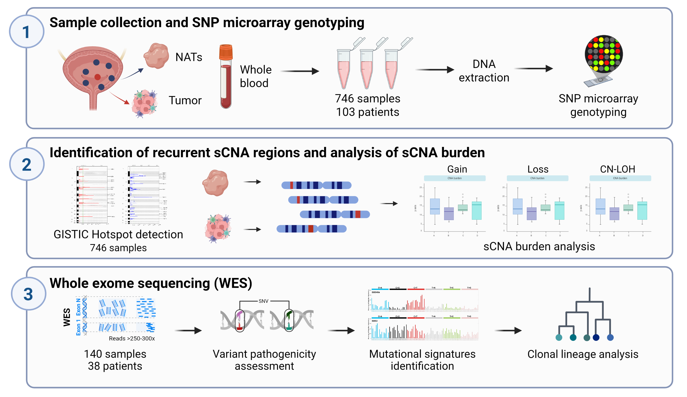

# Genomic analysis of bladder cancer and matched normal adjacent tissue (NAT)

### R | Bash | bcftools | PyClone-VI | ASCAT | MutationalPatterns | MoChA

This repository contains code used for the genomic analyses described in the ... paper.

The project's main goal is the **analysis of histologically normal bladder tissues adjacent to tumors (NATs) on a genomic level**. By conducting this study we were primarily interested in determining to what extent is the bladder cancerized field altered on a copy number and single nucleotide variant level and if these alterations target specific genes or regions of the genome. We focused primarily on the somatic copy number alterations, clonal relationships between tumors and NATs, and mutational processes across the urothelial cancerized field.



The repository contains two main analysis workflows.

## `CNA_burden/`

Analysis of cell-fraction-weighted somatic copy number alteration (sCNA) burden derived from MoChA calls.

### Biological questions

1. Do NAT samples contain sCNA burden in bladder cancer patients?
2. Is the sCNA burden associated with clinical parameters (tumor grade, stage, muscle-invasiveness) and/or patient characteristics (sex, age, smoking status)?

**The workflow includes:**

- genome-wide and chromosome-level sCNA burden calculation
- separate analysis of gains, losses, and copy-neutral loss of heterozygosity (CN-LOH)
- associations between tumor sCNA burden and clinical characteristics
- mixed-effects analysis of NAT sCNA burden
- patient-level sensitivity analyses
- analysis of NAT sCNA burden in relation to distance from the tumor

See `CNA_burden/README.md` for the complete workflow, inputs, statistical analyses, and outputs.

## `clonal_analysis_mutational_signatures/`

Whole-exome sequencing analysis of somatic SNVs and clonal relationships between tumors and matched NATs.

### Biological questions

1. Which mutational signatures are detectable in NATs?
2. Which somatic variants are present in both NATs and matched tumors, and do they belong to the same clonal lineage?
3. Which mutational signatures are present in NAT-specific, shared, and tumor-specific clonal lineages?
4. Which BLCA driver-gene variants occur in shared, tumor-specific, or NAT-specific clonal lineages?

The workflow includes:

- patient-level SNV force-calling across matched samples
- somatic SNV filtering and VAF calculation
- COSMIC SBS mutational signature analysis
- integration of allele counts with ASCAT copy-number and purity estimates
- clonal inference using PyClone-VI
- classification of shared, tumor-specific, and NAT-specific clonal lineages
- associations between clonal architecture and clinical characteristics
- mutational signature analysis across clonal compartments
- annotation of BLCA driver-gene variants and their distribution across clonal lineages

See `clonal_analysis_mutational_signatures/README.md` for the complete workflow and analysis details.

## Repository structure

```text
├── CNA_burden/
│   ├── README.md
│   ├── scripts/
│   ├── data/
│   └── results/
│
├── clonal_analysis_mutational_signatures/
│   ├── README.md
│   ├── scripts/
│   ├── data/
│   └── results/
│
├── README.md
└── .gitignore
```

## Reference genomes and software

The sCNA burden analysis uses GRCh37/hg19 coordinates, consistent with the MoChA-derived copy number data. The WES and clonal analyses use GRCh38/hg38.

Major software used across the workflows includes R, bcftools, ANNOVAR, MutationalPatterns, ASCAT, MoChA, and PyClone-VI. Exact parameters, software versions, required input files, and package dependencies are documented in the README within each analysis directory.

## Data availability

The repository contains analysis code and configuration files. Patient-level sequencing, clinical, and other controlled-access data are not included in the public repository. Raw files are deposited in an EGA repository (...).